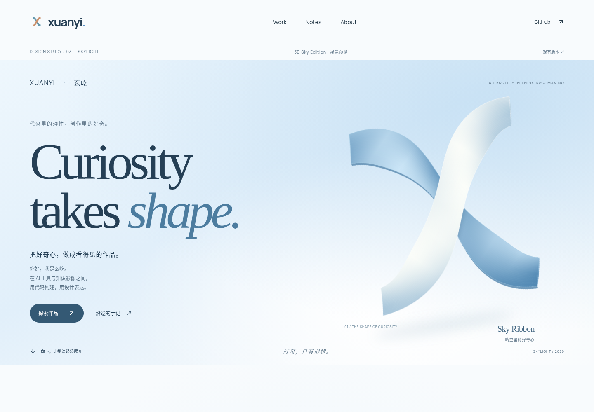
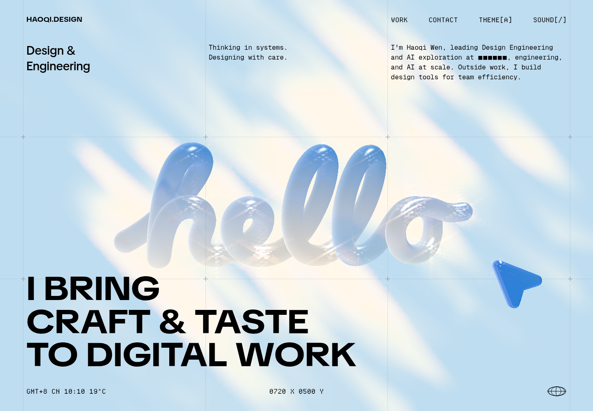

# 当前预览的独立艺术审查

> 第一阶段历史审计快照。第二阶段保存范围与来源复核见 [07-audit-publication.md](07-audit-publication.md)；文中的“尚未提交/尚未制作原型”描述第一阶段结束时的状态。

对象：`https://xuanyi-king.github.io/xuanyi-portfolio/`，版本见 [源码基线](01-source-baseline.md)。本轮直接观察真实运行画面，形成 [初步观察](evidence/initial-visual-notes.md)，再结合源码和性能结果。当前站与参考站均有本轮采集证据；不以旧报告评价或参考站样式代替对当前站的判断。

本报告是独立于旧报告的单一审查者判断，不是 Impeccable 完整 critique 执行，不包含伪造的专家共识或用户满意度分数。

## 先说已经成立的部分

画面不是没有设计：深蓝标题、蓝色斜体、哑光曲面 X 和暖白/晴空底色形成统一关系。H1 约 124px，H2 约 72px，层级明确；导航、作品 CTA、正文并不需要先解谜才能找到。手机把 X 排在标题之后、正文之前，390px 下没有把英文压成狭窄的竖条。[手机 Hero](evidence/live-mobile-hero.png)、[实际字体/章节数据](evidence/live-desktop.json)。

Living Gallery 有前后空间、侧向预告、拖动/方向键、循环和项目原生链接，已经超过普通平面卡片网格。本轮真实使用方向键切换得到 `02 → 03 → 01`，Enter 打开 Adaptive Router 详情，返回后计数 `01/03`。[切换画面](evidence/gallery-state-1.png)、[详情](evidence/project-detail.png)、[交互记录](evidence/network-and-detail.json)。不能把“保留轮播”本身列成设计缺陷。

## A–H 判断

| 维度 | 本轮判断 | 可复查证据 |
|---|---|---|
| A · Art Direction | 已有完整的色彩与字体家族；还偏一套优雅作品集系统，创作者的具体方法没有充分进入形式 | Hero 与 About/Notes 的共同蓝斜体语法；[尾段](evidence/live-desktop-scroll-4.png)；[SkyEdition:25](../../src/components/sky-edition.tsx#L25) |
| B · Composition | 左文右物的平衡稳定，Gallery 有纵深；文字和 X 大多占据独立区域，缺少前后遮挡、尺度碰撞或一个不可替换的构图关系 | [Hero](evidence/live-desktop-hero.png)；[sky.css:14](../../src/app/lab/sky-edition/sky.css#L14) 标题 55%、雕塑 left 50%/width 50%、正文 44% |
| C · Typography | 大字号/负字距/正斜体关系已成熟到可读；反复使用“罗马体前半句 + 蓝斜体后半句”使变化变得可预测，中文更像附属说明 | [Work](evidence/live-desktop-scroll-0.png)、[About](evidence/live-desktop-scroll-1.png)、[Notes/页脚](evidence/live-desktop-scroll-4.png)；[sky.css:15](../../src/app/lab/sky-edition/sky.css#L15)、[SkyEdition:38](../../src/components/sky-edition.tsx#L38) |
| D · Material & Depth | X 的扭曲、交叉与明暗让曲面成立，不能叫平面图标；当前更像经过法线着色的哑光带，缺少与同一空间光源、地面和环境共同成立的材质 | [Hero 原图](evidence/live-desktop-hero.png) 可放大见条带/端部细线；[sky-surface.ts:21](../../src/motion/sky-surface.ts#L21) 明确是正交投影及视角限定边缘/接触阴影近似；[sky.css:24](../../src/app/lab/sky-edition/sky.css#L24) 椭圆模糊投影 |
| E · Motion Direction | 有编排：转向、姿态峰值、缩小、淡出、Gallery 开口各有阶段。薄弱处是动作终点更多完成 Logo 收纳，项目内容缺少随之发生的有意义“接棒” | [运动状态](evidence/motion-states.json)、[中间帧 280px](evidence/motion-2.jpg)、[420px](evidence/motion-3.jpg)、[sky-transition.ts:4](../../src/motion/sky-transition.ts#L4) |
| F · Visual Continuity | Hero→导航的身份连续性成立，Hero→Gallery 的内容/材质连续性较弱；随后回到浅色分区和细线，空间故事没有持续发展 | [过渡](evidence/motion-3.jpg)、[Gallery→About](evidence/live-desktop-scroll-1.png)；[sky-hero.ts:41](../../src/motion/sky-hero.ts#L41) 主要联动 transform、opacity、16px 标题位移及最多 5% 的 Gallery 裁切 |
| G · Project Presentation | 三个项目及来源真实，概念封面也诚实标注；默认封面大于真实界面的可见优先级。触屏首页隐藏两块真实预览，个人作品证据需要点击后才能充分出现 | [Gallery 默认态](evidence/live-desktop-scroll-0.png)、[触屏态](evidence/touch-mobile-gallery.png)、[touch-mobile.json](evidence/touch-mobile.json)；[ProjectScene:49](../../src/components/project-scene.tsx#L49)、[identity.css:568](../../src/app/identity.css#L568) |
| **H · Design Personality** | **部分成立，尚不足够。X 是品牌线索，项目是个人证据；Hero 的结构和情绪仍较容易移植给另一家创意/AI 工作室。需要让“玄屹如何思考和制作”决定空间规则** | [Hero](evidence/live-desktop-hero.png)、[About/Notes](evidence/live-desktop-scroll-1.png)、[projects.ts:28](../../src/data/projects.ts#L28)；下文拆分换名测试 |

## H：换掉名字后，还剩下什么

这个测试不能偷换成“所有个人站都必须有奇怪交互”。这里分别检查识别符、形式和内容，结论不是“毫无原创性”。

**只更换 wordmark 与 byline：** 两列 Hero、抽象浮雕字母、衬线英文宣言、蓝色斜体和圆角 CTA 仍可用于另一位创作者或 AI 工作室。X 的形状和蓝白对比有记忆点，但画面并不需要知道 Adaptive Router、知识影像或人生经历叙事是什么才能成立。证据是三个内容区的布局互相独立，[SkyEdition:25–30](../../src/components/sky-edition.tsx#L25) 中 X 不承载项目关系，文案也以广义 curiosity 为中心。

**继续保留作品名和真实素材：** 全站就不能直接变成任意 AI 公司；DSH 原生路由设置、地图投影短片、知乎平行宇宙及其公开状态都是明确的个人实践。因此问题是“内容的专属性没有充分成为视觉的专属性”，不是凭空要求再造一个 Logo。

**下一轮要验证的原创主张：** X 的交叉可以表达“理性系统与知识影像相遇”，但这只是设计提案，不冒充作者既有自述。把路由的分支、影像的分镜和经历的路径组织成同一种空间语法；如果这套语法拿掉三个真实项目仍毫无变化，它就没有解决 H。不要用抽象节点、假数据或泛 AI 文案来充数。

建议下一轮做去名比较：隐藏姓名、wordmark 和 tagline，给相同真实内容的三个可运行版本做短时观察。问参与者记住了什么、理解作者在做什么，再记录反馈。当前没有进行这个用户测试，不提供虚构通过率。

## 五个最值得解决的核心问题

这些是艺术升级的优先级，不是功能阻断等级；现有站仍可正常作为作品入口。

| 顺序 | 核心问题与影响 | 证据 | 下一轮验证方式 |
|---|---|---|---|
| 1 | **品牌专属性主要靠名字和内容，形式没有讲清个人创作方法。** 第一眼容易记住“蓝白优雅”，未必记住“玄屹” | Hero + H 分析；[源码](../../src/components/sky-edition.tsx#L25) | 去名后比较 A 的文字雕塑、B 的连续画布、C 的实践台；参与者能否说出至少一个与真实项目有关的形式关系 |
| 2 | **构图和排版关系过于礼貌，章节的张力变化不足。** 重复的标题处理与宽松两列让文字、图形和内容保持距离 | [Hero](evidence/live-desktop-hero.png)、[About](evidence/live-desktop-scroll-1.png)、[Notes](evidence/live-desktop-scroll-4.png) | 每案做一个前后层次明确的构图、一次密度变化、一个中文参与主构图的状态；保持 CTA 可见与正文舒适行长 |
| 3 | **材质局部成立，空间中的光与体积关系不完整。** 只加厚阴影不会改变着色逻辑 | [原图](evidence/live-desktop-hero.png)、[法线着色](../../src/motion/sky-surface.ts#L57)、[固定投影](../../src/app/lab/sky-edition/sky.css#L24) | 用同一轮廓比较边缘厚度、接触/环境光与背景距离；旋转时检查光照是否仍自洽，明确预渲染与实时体积的区别 |
| 4 | **动效有阶段，缺少内容上的高潮与停顿。** X 的收束完成了身份功能，但没有充分建立“一个想法变成一个作品”的因果关系 | [中间帧](evidence/motion-3.jpg)、[转场函数](../../src/motion/sky-transition.ts#L4)、[Gallery 开口](../../src/motion/sky-hero.ts#L47) | 为每案只编排一个焦点动作，写出准备/发力/峰值/停顿/接棒；快滚、逆滚、键盘和 reduced-motion 均能理解结果 |
| 5 | **真实作品证据的主次落后于概念封面。** 访客先看到可迁移的插画风格，稍后才看到独属于作者的材料 | [默认封面](evidence/live-desktop-scroll-0.png)、[触屏隐藏](evidence/touch-mobile.json)、[媒体实现](../../src/app/identity.css#L430) | 首张即可看清真实 Router 局部/地图帧/故事界面，封面转为辅助；保留 Gallery，比较同内容下的吸引力和详情点击效率 |

## 对“结构性问题”的逐条核实

- **扁平：局部成立。** 背景缺少可读的近/中/远空间，文字和 X 很少交叠；但 Gallery 有真实透视，不能把整个网站判为扁平。
- **章节节奏单一：部分成立。** 色域、分割线和标题语法接近；高度并不统一。1440×1000 下 Hero 740px、Work 约1196px、About 约547px、Notes 约323px，[DOM 记录](evidence/live-desktop.json)。不应强制做成等高章节。
- **排版过度规律：主要在重复修辞。** 清楚的网格是优点；问题是多个英文标题都通过同一个蓝斜体收尾，缺少语义驱动的变化。
- **难忘构图：X 本身是亮点。** 目前缺少第二个能把 X、文字与真实作品同时组织起来的关键场景；这与增加元素数量无关。
- **孤立装饰：仅对内容关系成立。** X 会收束至导航且在 About/计数器出现，不能说完全孤立。它尚未影响项目如何被观看与理解。
- **卡片：不是普通静态网格。** Gallery 的空间和交互有效；仍可改进单个项目里相似的矩形封面/元信息模板和真实证据优先级。
- **运动：不是只有普通缓动。** `skyFrame` 有不同区间与正弦姿态峰值。问题在动作意义和停顿，不是曲线函数不够多。[分镜接触表](evidence/motion-contact.jpg)。
- **蓝天白云：当前主要是渐变空气，并非许多飘动的云。** 后续可以用天空反射、光照方向、遮挡和远近温差表达晴空，不必加云朵数量。[背景实现](../../src/app/lab/sky-edition/sky.css#L9)。

## 参考站观察：学习组织方式，不复制表面

参考站把高密度网格、巨大黑色宣言、作为文字的三维 hello、背景天空和指针物件放在同一视觉场。第二屏换成个人照片与大段明确职业叙述，密度与材料都有明显变化。[第二屏](evidence/reference-desktop-work.png)。可以借鉴“字体成为物体”“网格跨区域约束”“个人证据早出现”和节奏切换。

XUANYI 不应照搬 hello、黑色巨字、像素坐标、照片签名或声音按钮；这些都不是玄屹已建立的品牌承诺。本轮仅观察参考站这两个视口，没有据此宣称完成其全站动效审查。

## 工程与性能：已应用 Vercel React 规则

| 检查 | 实际发现 | 结论/下一步 |
|---|---|---|
| 动画重复渲染 | [sky-hero.ts](../../src/motion/sky-hero.ts#L23) 用数值弹簧直接写 wrapper transform；[Gallery:66](../../src/components/living-gallery.tsx#L66) 每帧写 DOM，只有 active index 变动才 setActive | 没有“每个滚动帧都 React setState”的源码证据。保留 refs/controller 路径；未运行 React Profiler，不宣称零重渲染 |
| SVG 动画路径 | [SkyEdition:14](../../src/components/sky-edition.tsx#L14) drive 固定 force=0；姿态由 div 负责。曲面来自 SVG 采样，法线与光照不随 wrapper 旋转实时重算 | 符合 animate-svg-wrapper 的方向；同时解释了材质在动态中偏二维的上限。不要为了增加体积每帧重建所有 path/stop |
| 布局读写 | measure 中先写 `transform='none'` 再读 rect；pointer 中读 hero rect；常规 scroll draw 不逐帧测量 | [sky-hero.ts:30](../../src/motion/sky-hero.ts#L30)。存在待 trace 的测量成本，尚无连续 layout thrashing 证据；下一轮做一次 Chrome trace 后决定是否缓存/批量读取 |
| 脚本体积 | Taste 三次取样：两宽度 JS parsed 675.8KiB，传输约227KiB；整页约810KiB | 有优化空间，不能凭总量断言 GSAP 是主因；先做 bundle/source-map 归因，再考虑延迟 Lab/非首屏代码，禁止隐藏首屏 X 来“优化” |
| 资源加载 | 3 个字体文件约79KiB；图片有尺寸且折下 lazy。手机仍下载约269KiB 图片，接近桌面 | 位图的响应式源值得核实。脚本 oversized 项包含 SVG，不能因 SVG 的 naturalWidth 就判浪费；真实 jpg 需按带宽、裁切和 DPR 单独判断 |
| 布局稳定 | 桌面 CLS 中位0.010、手机0.000；LCP分别416/332ms | 仅本云端 CPU 浏览器相对基线，三次范围见原始结果；不代表真机、慢网或现场 Core Web Vitals |
| 失败请求 | Taste 两宽度各标6个 broken requests；另一次浏览器观察记录多个 `fetch net::ERR_ABORTED`，未记录 HTTP≥400，详情能打开 | 保留告警，未证实是死链接。下一轮按 initiator/RSC prefetch/导航时序定位，不为了“全部通过”删除失败记录 |

原始 [taste-perf.json](evidence/taste-perf.json)、[完整输出](evidence/taste-perf.log) 的总结仍是 **FAIL（3项 FAIL、3项 WARN，跨两宽度合计）**。本轮不重构源码来消除告警，不把人工解释写成脚本 PASS。

测试环境为云端 Chromium，390px 是模拟视口，额外检查了 `hasTouch/isMobile` 的 hover:none 路径；没有实际手机、Safari 或屏幕阅读器验收。录屏按样本帧观察，未宣称人眼完整原速播放或恒定60FPS。
