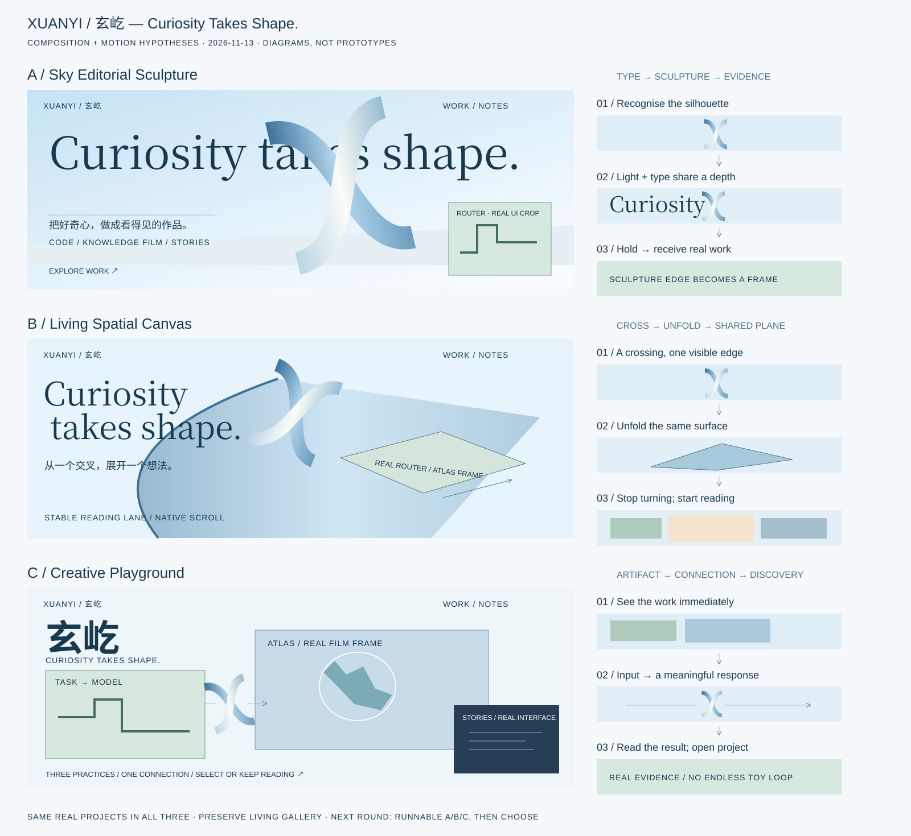

# 三个原创视觉方向 · 待验证提案

> 第一阶段历史审计快照。第二阶段保存范围与来源复核见 [07-audit-publication.md](07-audit-publication.md)；文中的“尚未提交/尚未制作原型”描述第一阶段结束时的状态。

保留 **XUANYI / 玄屹 · Curiosity Takes Shape.**，晴空、明亮、舒适、精致3D仍是共同约束。三案使用相同的三个真实项目与同一篇手记，不靠更换内容或虚构案例制造差异。

下方是**构图和运动关系图**，用于解释下一轮要验证的不同空间逻辑，不是最终视觉稿，不是材质样片，也不是已完成的可运行原型。本阶段止于工具准备、审查和原型计划。

可单独打开 [SVG 图解](concept-atlas.svg) 或 [PNG 预览](evidence/concept-atlas.png)。图中的占位面是具体素材的安装位置：Router 真实设置局部、ATLAS 成片帧、知乎真实界面；不能在原型里继续用空框代替它们。

## A · Sky Editorial Sculpture / 晴空雕塑刊

**核心命题：** 让“好奇成形”成为一页可以走近的雕塑出版物。主角不是右侧装饰 X，而是文字、X 和展台光线共同组成的一幅画。三案中最适合作为可读性与材质精修的比较锚点。

| 项目 | 设计说明 |
|---|---|
| 核心视觉主角 | 一个足以跨越标题字场的 X；上半部迎光、下半部进入近景。大字是空间的一部分，X 遮住一个字的局部而非挡住核心文案 |
| Hero 构图 | 取消对称的左右独立区。标题在后景横跨画面，X 在中景偏中心，中文 byline/正文在下方左侧近景；右下角有一块真实作品切片，作为“雕塑通往作品”的接收点 |
| 字体语言 | 使用现有本地衬线作为基线，比较更有张力的字宽/断行/光学字距，而不是先加字体；定制 XUANYI 字标局部比例。“玄屹”作为可见的编排锚点，不再只当小字号翻译。正文保持易读 sans，斜体只服务一个语义重音 |
| X 材质 | 蓝色缎面釉与乳白细哑光的对照；边缘厚度、交叉接触、单一晴空主光应一致。先用同轮廓的高质量离线渲染/静帧对照既有 SVG；若实时转角超出资产可信范围，缩小运动范围，不能用平面倾斜冒充动态体积 |
| 背景空间 | 晴空光井：上方偏冷天光、下部有明确但轻的承接面/地平关系。禁止依赖浅蓝渐变本身充当空间；天空不必画成云朵 |
| 关键动效 | 准备：轮廓完整可读；发力：光线沿交叉处越过；峰值：中景 X 与后景标题短暂形成遮挡；停顿：读出 tagline；接棒：交叉的某个边界成为第一件作品的画框边缘。只做一次焦点编排，不给每段重复入场 |
| 作品展示 | 保留 Living Gallery，将中心作品呈现为展台上的“实物证据”；Router 默认展示真实控件，Film 默认真实帧，概念封面作为次级内页/背面，不依赖 hover 才显真相 |
| 移动端 | 将三层压成纵向但保持一次明确的前后关系，标题关键字和 CTA 不被盖住；不把桌面大雕塑简单缩小挤进右侧；真实作品默认可见 |
| 性能成本 | 相对低到中；单张移动/桌面优化材质资产或既有 SVG + wrapper；不新增常驻渲染循环。离线渲染生成成本与网页运行成本分开记录 |

**待回答问题：** 当标题和雕塑共享空间后，读者是否更记得作者，而非记得另一个漂亮艺术杂志站？A 的风险是过度编辑感掩盖创意开发者的实践，需要真实界面切片校正。

## B · Living Spatial Canvas / 想法的折面

**核心命题：** 同一块连续画布从 X 的一面展开，成为项目的观看平面；“代码构建、设计表达”的两条实践在交叉处相遇。主角是关系变化，X 是空间的起点而非独立摆件。

| 项目 | 设计说明 |
|---|---|
| 核心视觉主角 | 一块有方向、尺度和前后关系的连续折面。X、文字行基线、Gallery 中心面服从同一条空间轴 |
| Hero 构图 | 非居中的斜向张力：大 X 只露出关键交叉，标题沿折面外侧排布，真实项目一角先进入远景。不是把全部东西旋转；导航和正文保留稳定的水平阅读面 |
| 字体语言 | 宣言的断行由画布开口决定；中文作为沿途注释参与空间，关键叙述始终保持正面阅读。小型等宽标注只用于真实制作信息，不加虚构坐标和技术假数据 |
| X 材质 | 蓝白复合薄壳，明确厚度和曲率。材质变化服从同一光源；折面打开时观察背面，不能只有正面渐变。第一轮可用既有曲面 + 分层平面回答构图问题，同时标记未验证的真实体积缺口 |
| 背景空间 | 一个晴空下的连续工作场：由近景边缘、画布投影与远景反射建立深度；不以三个互不相干的渐变 section 拼接 |
| 关键动效 | 准备：交叉形态；发力：沿一条边展开；峰值：观看面从斜面转为正面，真实 Router/Film 内容出现；停顿：可阅读/点击；接棒：相同平面承载 Living Gallery 的横向运动。逆滚沿同一关系返回，不另播一段动画 |
| 作品展示 | 仍是 Living Gallery，但作品以共享画布上的三个“窗口”出现，切换改变观看位置；单个窗口素材与布局可因路由/电影/故事而变化。保留可见上一件/下一件、计数和直接详情入口 |
| 移动端 | 手指纵向滚动保持原生；把复杂转面改为单次轻折开口，不强制锁屏或横向滚动。触摸横拖只在 Gallery 成立且不阻断纵向；reduced-motion 提供静态展开面 |
| 性能成本 | 三案最高风险：clip/mask 和多个变换层可能增加重绘与显存。先固定少量层，用既有 GSAP/数值控制器；不默认新增 WebGL 或动画框架。需 trace 证明成本，材质实时渲染另作小实验再决定 |

**待回答问题：** 访客能否自然理解“同一面变成作品空间”，而不是只看见又一次缩放与裁切？B 对当前第4个问题最直接，建议在下一轮优先做最薄的 Hero→首件作品连续性切片。

## C · Creative Playground / 好奇实践台

**核心命题：** 访客先看见作者做过的东西，再发现这些东西如何被一个小巧的 X 连接。乐趣来自能被解释的创作因果，不来自到处乱跳的物件。

| 项目 | 设计说明 |
|---|---|
| 核心视觉主角 | 三件真实作品组成的不等尺度实践台；X 是交叉的铰接/连接位置。主角从“作者的标志”变成“作者的制作” |
| Hero 构图 | 大片真实地图影像作为横向主面，Router 控件局部是一条竖向轨道，经历界面是边缘的一张可读材料。大字 XUANYI/玄屹与这些材料咬合；tagline 保留为清楚短句 |
| 字体语言 | 更鲜明的现代 sans 与定制字标比例；中文姓名在首屏承担主要视觉重量。少量衬线用于知识影像/笔记的引用，避免整页复用蓝斜体公式 |
| X 材质 | 可触知的蓝白陶瓷/精密塑料铰接件；不做廉价软糖感。触发时是一段短而可中断的形态响应，随后回到稳定阅读态 |
| 背景空间 | 明亮浅色制作台与干净天空反射；元素落在可理解的工作平面，前后位置不是随机散落。小面积暖色只取自真实项目，不另外添一套玩具色盘 |
| 关键动效 | 准备：完整真实作品；点击/聚焦某个实践：X 转向该材料；峰值：路由连线或地图投影的一个真实关系得到解释；停顿：读结果；接棒：进入对应项目。第一次停留可有一次轻提示，不自动循环逗弄 |
| 作品展示 | Hero 已是精选作品入口，下方 Gallery 继续浏览完整集合；同项目共享可识别的构图锚点。三件作品的观看方式差异来自内容，不是三个同款卡片换颜色 |
| 移动端 | 一次只突出一件作品，保留其余两个明确入口；点击等价于 hover/键盘焦点，不要求拖拽才能浏览；X 留在边缘，操作目标建议至少44px |
| 性能成本 | 中等；事件触发、按需停止的局部动效。首屏短片默认 poster，点击后才加载/播放轻片段；支持静态替代、无声音默认、失焦/离屏停止。多项目不同时启动重型动画 |

**待回答问题：** 没有字标时，访客是否仍能从真实材料和响应方式认出这是玄屹的实践？C 最有机会改善品牌专属性，但必须防止界面像杂乱的工具演示台。

## 比较建议

| 比较轴 | A | B | C |
|---|---|---|---|
| 构图中心 | 文字与雕塑同场 | 一张面跨越状态 | 三件作品与交叉连接 |
| 主要输入 | 阅读与纵向滚动 | 纵向滚动驱动关系 | 点击/焦点选择实践，滚动继续浏览 |
| 首要验证 | 字体与材质是否共同产生品牌 | 连续性是否直观、有停顿 | 真实作品是否先建立个性 |
| 最大风险 | 精美但仍可迁移的杂志语言 | 昂贵、晕动、内容被效果遮挡 | 入口争夺注意力、玩具化 |

这不是本轮预选胜出方案。建议下一轮先做 **B 的连续性切片**，再完整搭建同等内容的 A/B/C；A 提供阅读/材质锚点，C 检查个人证据优先的另一种结构。只继承经运行验证的关系，不把三案简单混成“更多效果”。
