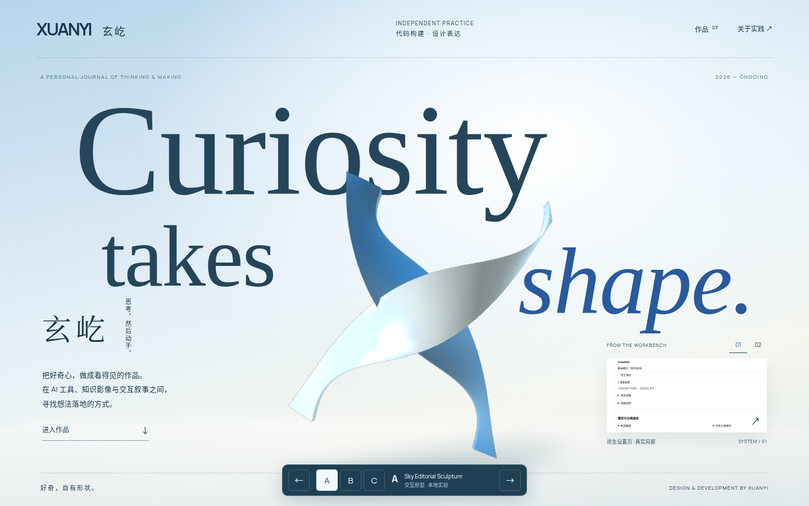
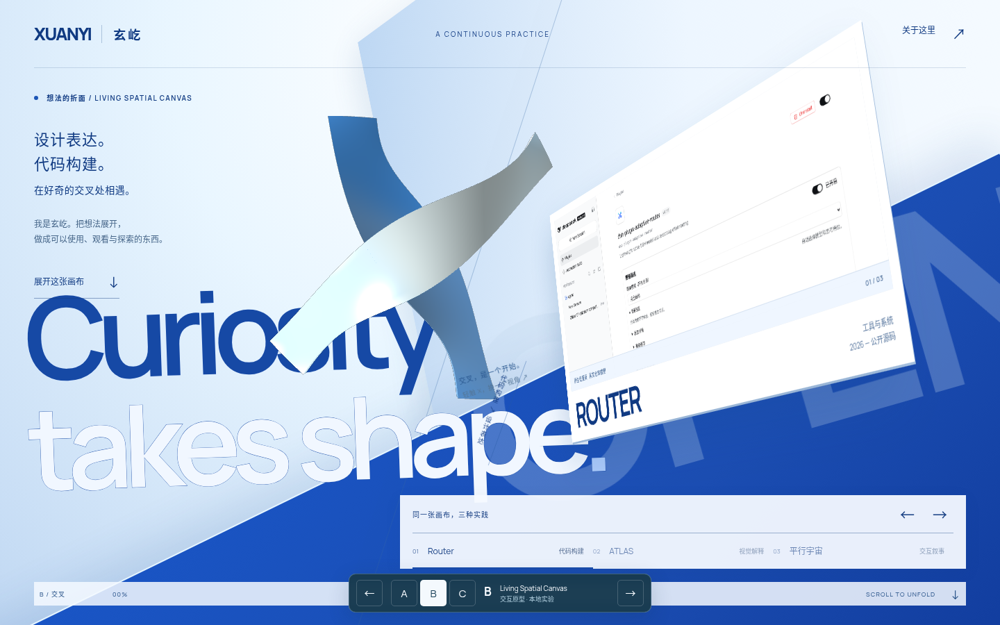
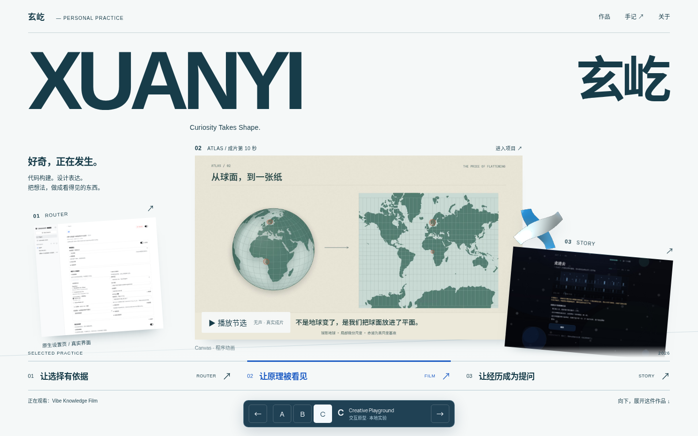

# 三套交互原型的设计比较

建议：**下一轮以 C 为主方向，B 保留为连续空间实验，A 作为排版和材质的参照。** 这是关于品牌方向的建议，不是批准集成；三案都还不是可以直接替换首页的生产成品。

## 独立观察的范围

独立视觉审查代理先看六张桌面/手机画面、交互与作品状态，再为 A/B/C 各打开桌面和触屏模拟的新 Chromium context，实际检查 A/B 短距离滚动与 C 的 Story 选择。它未阅读三位实现者的自评，未做性能循环或完整原速视频观影。该轮检查发生在6752三角形的初版；随后仅将网格降到4304、缓存未变换的画布尺寸并修复隐藏焦点，构图没有改换。主代理又查看最终截图及六段影片各10个时点的接触表，并运行完整交互路径。**不声称有人完整原速看过所有影片，不伪造用户测试或艺术评分。**

## A · Sky Editorial Sculpture

- **品牌辨识/原创性：** 巨型字场、中央 X 和前景斜体确实组成一幅画，脱离了旧版左文右物。中文姓名、竖排短句与作者说明进入主构图。但去掉名字，英文 curiosity 宣言、蓝银雕塑与编辑式留白仍可移植给很多设计师，H 尚未解决。
- **构图/字体：** 三层遮挡和尺度关系是三案里最完整的字体雕塑研究。手机重新编排文字、雕塑与中文说明，而非缩小桌面两列。作品切片在桌面仍很小，手机较靠后；“真实作品”还没成为第一主角。
- **运动：** 有一次字场/雕塑入场、可交互姿态和可逆章节交接；Gallery 复用了原有可靠控制器。首屏的独特构图没有完全变成后续作品观看规则，后段仍回到正体+蓝斜体的既有修辞。
- **材质：** 大尺寸最能展示曲率、厚度和光照变化，也最容易暴露高光近纯白、边缘锯齿与缺少共同地面的问题。它是程序化天空光照近似，不是完整物理渲染场景。
- **舒适度/成本：** 阅读路径清楚、Gallery键盘/拖动能力保留，真实媒体默认出现。大画布与已有 Gallery 的 DOM/脚本成本较高；当前云端滚动采样未达到把它作为流畅度标杆的标准。

## B · Living Spatial Canvas

- **品牌辨识/原创性：** 斜切地面、透视作品窗、巨大 sans 和 X 共处一个方向场，三案中空间构图最有力度，明显远离普通 AI 落地页。但“把想法展开成画布”仍是通用比喻，换另一组软件/影片/交互项目也基本成立。
- **构图/字体：** 横向展开的字与蓝色折面构成张力；进入观看状态时项目窗转正，左侧文字安定下来。[正面观看](evidence/B-1440-chromium-work.png)。手机有单独的折叠构图，但中间状态的 X、斜窗、地面、大字与导航同时竞争注意力。
- **运动：** “倾斜展示→正面观看”是最明确的运动终点，滚动可逆、原生，不劫持输入。X 和折面仍属于两个渲染层：当前证明了共同编排，尚未证明它们是同一物体连续展开，不能把这种缺口称为已完成。
- **材质：** X 有真实厚度、透视和可变明暗；项目窗/地面是 CSS 空间，不具备与 X 共同计算的遮挡、自投影或照明。复杂并不等于材质更高级。
- **舒适度/成本：** 已修正底部控件在蓝面上的低对比；作品选择与详情入口在观看停顿成立。粘滞长场景、多层透视和过渡可读性，是三案中维护与运动舒适度风险最高的部分。

## C · Creative Playground

- **品牌辨识/原创性：** 首屏直接展示真实地图成片、Router 设置与叙事界面；“让选择有依据 / 让原理被看见 / 让经历成为提问”将具体项目组织成方法。去掉名字后，仍能看出这个人做过什么，最接近回答 H。
- **构图/字体：** 大字 XUANYI/玄屹、横向影片、竖向设置与暗色故事组成实践台，避免三张同款概念卡。中文承担核心叙述，移动端把真实主素材置前、另外两件变成可触摸入口。巨大姓名仍消耗首屏高度，主图+两侧倾斜材料的骨架也并非不可移植。
- **运动：** 切换项目直接改变观看主次和下方解读，因果清楚；影片只在点击后播放，并在离屏/隐藏/降级时停止。可逆滚动从材料台进入具体项目。小 X 的短响应还不能解释三种实践为何相交，下一轮应让选择关系更具体，而不是添加更多玩具动效。
- **材质：** 紧凑陶瓷式交叉件与前两案不同，但当前更像连接标识而非空间结构。小尺寸降低了开销，也降低了材质细节的视觉权重。
- **舒适度/成本：** 主图可读、选择明确、键盘/触摸等价，观看负担最小；不要求访客等待大型场景展开才能知道作者做什么。仍需真实手机/Safari、慢网、完整辅助技术与动态效果的进一步验收。

## 关于 H 的结论

A 主要改善艺术完成度，B 主要改善空间戏剧性，**C 最有效地让真实内容和作者方法主导观看**。C 不是形式最稀奇的一案，却最难仅换 Logo 就变成另一家 AI 工作室。

下一轮建议只深化 C 的一条具体关系：选择 Router、影片或故事时，让“选择/解释/提问”的视线与空间位置发生可读变化，并检验访客是否理解作者的实践。以 A 作为字体/材质质量参照，以 B 的可逆接棒经验帮助局部转换；不要把三案的效果机械累加。

本轮没有进行真人去名测试。上述 H 结论是独立视觉判断与真实运行证据支持的提案，不是验证过的用户记忆率。
