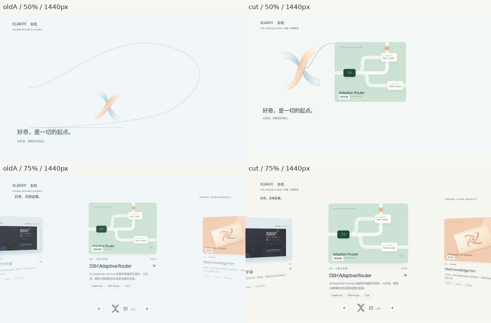

# The Passing Curve · Director’s Cut evidence

**精修A进入Lab，正式首页保留2.2。** [完整交付报告](../../motion-direction-2-3/directors-cut/report.md) · [艺术判断](../../motion-direction-2-3/directors-cut/decision.md) · [性能全表](../../motion-direction-2-3/directors-cut/performance.md) · [观看与验证限制](../../motion-direction-2-3/directors-cut/verification.md)。

视觉/测量源码3d0a4d96ce3a498edb0234b344470b5672062809；精确2.2基线75a1e19；旧A453caa4。后续报告与证据提交不改变运行时视觉。没有生成截图或伪软件UI，JPEG仅缩小/排列/标注真实浏览器图。原始PNG哈希在[source-manifest](source-manifest.json)。

## 关键比较

- [1440：旧A50% / 新50%；旧A75% / 新75%](comparison-1440.jpg)。
- [390：相同最差阶段比较](comparison-390.jpg)。
- 完整八帧0/25/40/50/60/75/90/100：[1440](keyframes-1440.jpg) · [768](keyframes-768.jpg) · [390](keyframes-390.jpg) · [320](keyframes-320.jpg)。

## 完整实际录屏与已检查序列

PR最新Portfolio CI → browser-evidence Artifact → `passing-curve/films/`，保留14天；可用同提交重新生成。六个完整WebM：`director-1440.webm`、`director-390.webm`、`director-320.webm`、`scroll-1440.webm`、`scroll-390.webm`、`scroll-320.webm`。后三个包含下滚、中途停住、快速反向、直接越过舞台、Gallery接管后拖动；手机片尾用实际CDP touch输入。

[本机影片manifest](film-manifest.json)含全片时长、SHA256、全帧解码状态和558个8fps采样画面。全部12张contact sheets都已实际检查；这仍然**不等于实时原速观看**，工具限制见验证说明。原始WebM与静态contact sheets的用途不同。

|完整片|0–8秒密集序列|8秒至片尾|
|---|---|---|
|桌面预演|[part1](director-1440-1.jpg)|[part2](director-1440-2.jpg)|
|390预演|[part1](director-390-1.jpg)|[part2](director-390-2.jpg)|
|320预演|[part1](director-320-1.jpg)|[part2](director-320-2.jpg)|
|桌面原生滚动|[part1](scroll-1440-1.jpg)|[part2](scroll-1440-2.jpg)|
|390原生滚动|[part1](scroll-390-1.jpg)|[part2](scroll-390-2.jpg)|
|320原生滚动|[part1](scroll-320-1.jpg)|[part2](scroll-320-2.jpg)|

## 数据

- [三轮普通原始数据](normal.json)：18组原生滚动 +12组导演预演，包含所有不利轮次。
- [6组独立profile分析](profiles.json)；raw trace/CPU profile在Artifact `passing-curve/performance/`。
- [旧A逐项诊断](audit.json)；raw诊断trace在Artifact `passing-curve/audit/`。
- [三引擎12组通过日志，影片首帧修正前](three-engine-pre-film.log)；[首帧修正后的本机Chromium4组](local-chromium-results.json)。最新全部引擎结果由CI的`passing-curve/browser-results.json`提供，不混淆不同markup轮次。

- [原首页12组，目标状态等待后的结果](homepage-identity-results.json)；两次失败日志及隔离比较见验证说明，未删除失败。

## 复现

`npm ci && npm test && npm run typecheck && npm run build && npm run check:export`。

服务out到4187端口（4190是Firefox限制端口）；设置`BROWSER_BASE_URL=http://localhost:4187`运行`npm run check:passing`、`npm run record:passing`。三引擎按Playwright官方方式安装及准备运行库。

`npm run compare:passing`自动获取两个精确历史SHA、各自npm ci/build，顺序采集旧A截图、诊断、三轮轮换样本与独立profile。确保4187/4189/4191端口空闲。测量期间不要同时跑构建、测试、录屏或FFmpeg。

对照入口仍为Lab中的A Continuous Thread / B Spatial Unfolding。正式首页未改成实验。
